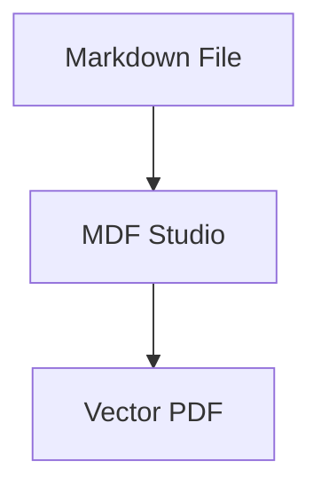

# 📄 MDF Studio - Markdown to PDF Converter

**MDF Studio** is an easy-to-use, publication-grade Markdown to PDF converter designed for developers, researchers, technical writers, and students. It provides both an interactive, state-of-the-art **Web Studio** with real-time paginated paper simulation and a lightning-fast **Command-Line Interface (CLI)**.

---

## 🌟 Key Features

### 🖥️ Interactive Web Studio
- **Dual-Pane Live Split Screen**: Real-time synchronized markdown editing on the left and a paginated physical paper preview on the right.
- **Realistic Paper Simulation**: Displays actual physical paper dimensions (**A4, US Letter, Legal, A5, A3**) in Portrait or Landscape with drop-shadows and page boundary markers.
- **Smart Auto-Fit & Zoom**: Automatically fits the document sheet to your display width, with manual zoom controls (40% to 200%).
- **Synchronized Scrolling**: Smooth bi-directional scrolling between the raw markdown editor and the rendered paper.
- **100% Client-Side & Private**: Your files and documents never leave your computer. Full offline capability with zero external servers.

### 🎨 11 Designer Document Themes
1. **Modern Tech**: Clean Inter sans-serif typography, rounded code blocks, vibrant callout boxes, and tech-doc styling.
2. **Academic Research**: Formal Merriweather/Times serif, justified text, IEEE-style headings, centered math, and booktabs tables.
3. **Executive Slate**: Corporate navy accent headers, executive summary formatting, and structured financial tables.
4. **Editorial Book**: Literary Playfair Display typography, warm reading tones, and generous paragraph measure.
5. **Minimalist Swiss**: Bauhaus-inspired monochrome high-contrast grid, architectural precision, and stark borders.
6. **Nordic Frost**: Scandinavian minimalist styling with cool Arctic cerulean blues, soft frosted slate, and airy tracking.
7. **Cyber Dark**: Futuristic obsidian presentation deck with neon cyan and electric violet glowing accents.
8. **Warm Botanical**: Earthy forest sage, warm terracotta accents, and organic natural paper tones.
9. **Retro Typewriter**: Vintage Courier mechanical manuscript with monospaced tables and typewriter stamp callouts.
10. **Legal Brief**: Formal jurisprudence, contract clause styling, numbered recitals, and solemn legal typography.
11. **Creative Studio**: Bold sunset coral and electric violet gradients, floating card callouts, and contemporary agency styling.

### 🔬 Rich Content Capabilities
- **KaTeX Vector Mathematics**: Inline formulas (`$E=mc^2$`) and display equation blocks (`$$\int_{-\infty}^\infty e^{-x^2} dx = \sqrt{\pi}$$`).
- **Mermaid.js Diagrams**: Render flowcharts, sequence diagrams, gantt charts, and architecture maps directly into vector SVGs.
- **Prism.js Syntax Highlighting**: Auto-highlighting across Python, JavaScript, TypeScript, Bash, SQL, HTML, CSS, JSON, and Rust.
- **GitHub Alert Callouts**: Native support for `> [!NOTE]`, `> [!TIP]`, `> [!IMPORTANT]`, `> [!WARNING]`, and `> [!CAUTION]`.
- **Automatic Table of Contents**: Type `[TOC]` or toggle in settings to generate an outline with anchor links.
- **Clean Page Breaks**: Insert `---page-break---` or `<div class="page-break"></div>` anywhere to control page flow.
- **Automatic Image Embedding**: Drag and drop or paste any image from your clipboard directly into the editor; it automatically embeds as Base64 so your offline PDF never breaks!
- **Running Headers & Footers**: Customize document title, author, date, and dynamic page numbers (`Page X of Y`).
- **Cover Page Generator**: Generate a formal front cover page with custom title, subtitle, author, and date.

---

## 🚀 Quick Start

### 1. Launch the Web Studio
You can run the built-in zero-dependency local dev server:
```bash
npm start
```
*Or:*
```bash
node server.js
```
The server will open your default browser to `http://localhost:3456`.

> **Note:** You can also simply double-click `index.html` to run it directly from your local filesystem in Chrome, Edge, Safari, or Firefox without starting a server!

---

### 2. Command-Line Interface (CLI)
MDF Studio includes a headless Chromium/Edge-powered CLI that converts markdown files directly to vector PDFs from your terminal in seconds:

```bash
# Basic conversion (creates input.pdf)
node cli.js sample.md

# Specify output filename and theme
node cli.js paper.md research.pdf --theme academic --size a4

# Executive proposal in landscape orientation with open flag
node cli.js proposal.md executive_summary.pdf --theme executive --landscape --open
```

#### CLI Options
| Flag | Description | Options / Defaults |
| :--- | :--- | :--- |
| `--theme` | Document styling theme | `modern` (default), `academic`, `executive`, `editorial`, `minimalist` |
| `--size` | Paper sheet size | `a4` (default), `letter`, `legal`, `a5`, `a3` |
| `--landscape` | Landscape orientation | Default is portrait |
| `--margins` | Page margins | `normal` (20mm, default), `compact` (12mm), `spacious` (28mm) |
| `--open` | Open PDF upon completion | Automatically opens in default PDF viewer |
| `--help, -h` | Display CLI help | |

---

## ⌨️ Keyboard Shortcuts

| Shortcut | Action |
| :--- | :--- |
| **Ctrl + P** / **⌘ + P** | Export Vector PDF (High-Resolution Browser Print Engine) |
| **Ctrl + S** / **⌘ + S** | Direct PDF File Download |
| **Ctrl + B** / **⌘ + B** | Bold selected text |
| **Ctrl + I** / **⌘ + I** | Italicize selected text |
| **Ctrl + /** / **⌘ + /** | Open Keyboard Shortcuts cheat sheet |
| **Ctrl + V** / **⌘ + V** | Paste clipboard image (auto-embeds as Base64) |

---

## 💡 Markdown Syntax Guide

### Page Breaks
Force content onto a new page in the exported PDF:
```markdown
---page-break---
```

### GitHub Callout Alerts
```markdown
> [!NOTE]
> This is a helpful note.

> [!TIP]
> Pro-tip for users.

> [!WARNING]
> Proceed with caution.
```

### Math Equations (KaTeX)
```markdown
Inline equation: $f(x) = x^2 + 2x + 1$

Block equation:
$$\frac{-b \pm \sqrt{b^2 - 4ac}}{2a}$$
```

### Mermaid Diagrams
````markdown

````

---

## 📦 Project Structure

```
MDF/
├── index.html              # Main Web App UI
├── server.js               # Zero-dependency local server with auto-open
├── cli.js                  # Headless Chromium/Edge CLI PDF converter
├── package.json            # npm metadata & scripts
├── sample.md               # Feature-rich showcase markdown document
├── css/
│   ├── app.css             # Studio chrome, dark theme, split layout
│   ├── preview.css         # Simulated paper canvas & @media print engine
│   └── themes/             # Document styling themes
│       ├── modern.css      # Modern Tech
│       ├── academic.css    # Academic Paper
│       ├── executive.css   # Executive Slate
│       ├── editorial.css   # Editorial Book
│       └── minimalist.css  # Minimalist Swiss
├── js/
│   ├── app.js              # State manager & reactive coordinator
│   ├── parser.js           # Markdown pipeline (Marked, KaTeX, Prism, Mermaid)
│   ├── pdf-export.js       # Vector Print engine & direct PDF download
│   ├── templates.js        # Professional document templates
│   └── ui-controls.js      # Toolbar, drag-and-drop, zoom, auto-fit, sync scroll
└── vendor/                 # Local vendor libraries for 100% offline operation
```

---

## 📄 License
MIT License. Free for personal and commercial use.
