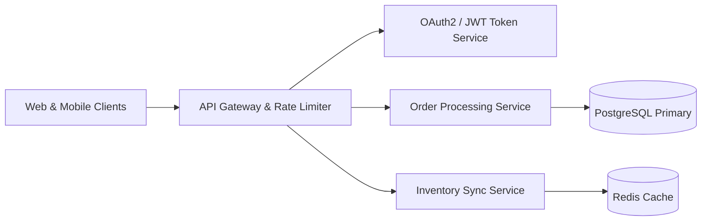

# MDF Studio - Markdown to PDF Showcase

> [!NOTE]
> This sample document showcases the complete capabilities of **MDF Studio**, including mathematical formulas, code blocks, tables, callouts, and multi-page layouts.

---

## 1. Mathematics & Science (KaTeX)

MDF Studio renders vector-crisp equations inline and in display blocks.

The Maxwell-Boltzmann distribution describes particle speeds in idealized gases:

$$f(v) = \sqrt{\left(\frac{m}{2\pi k T}\right)^3} 4\pi v^2 \exp\left(-\frac{m v^2}{2 k T}\right)$$

Quantum harmonic oscillator wavefunctions:

$$\psi_n(x) = \frac{1}{\sqrt{2^n n!}} \left(\frac{m\omega}{\pi \hbar}\right)^{1/4} \exp\left(-\frac{m\omega x^2}{2\hbar}\right) H_n\left(\sqrt{\frac{m\omega}{\hbar}} x\right)$$

Inline formulas: Gaussian integral $\int_{-\infty}^\infty e^{-x^2} dx = \sqrt{\pi}$ and Einstein's mass-energy equivalence $E = mc^2$.

---

## 2. Code Syntax Highlighting

Full syntax highlighting across Python, JavaScript, TypeScript, Rust, Go, SQL, and Bash:

```python
import asyncio
from typing import AsyncGenerator

async def fetch_event_stream(endpoint: str) -> AsyncGenerator[dict, None]:
    """Asynchronously stream JSON events from cluster gateway."""
    async with aiohttp.ClientSession() as session:
        async with session.ws_connect(f"{endpoint}/v1/stream") as ws:
            async for msg in ws:
                if msg.type == aiohttp.WSMsgType.TEXT:
                    yield msg.json()

# Run event loop
asyncio.run(fetch_event_stream("wss://stream.internal"))
```

---

## 3. High-Contrast Data Tables

| Module | Language | Latency (p95) | Memory Allocation | Health Status |
| :--- | :---: | :---: | :---: | :---: |
| Ingestion Gateway | Rust | 1.2ms | 28 MB | 🟢 Healthy |
| Auth Interceptor | Go | 0.8ms | 14 MB | 🟢 Healthy |
| Schema Validator | TypeScript | 3.4ms | 45 MB | 🟡 Warning |
| Log Compactor | C++ | 0.4ms | 110 MB | 🟢 Healthy |

---page-break---

## 4. GitHub-Style Alerts & Callouts

> [!TIP]
> Press `Ctrl + P` to trigger high-resolution vector PDF export in your browser!

> [!IMPORTANT]
> Always verify table column widths when targeting compact A5 or mobile paper dimensions.

> [!WARNING]
> Mermaid diagrams require client-side JavaScript execution to render SVG vector nodes.

---

## 5. Architectural Diagram (Mermaid)



---

## 6. Actionable Checklist

- [x] High-precision vector typography
- [x] Multi-theme support (Modern, Academic, Executive, Editorial, Minimalist)
- [x] Live synchronized split-screen editor
- [x] Client-side offline operation
- [ ] Direct cloud synchronization

> *"A designer knows he has achieved perfection not when there is nothing left to add, but when there is nothing left to take away."*  
> — Antoine de Saint-Exupéry
